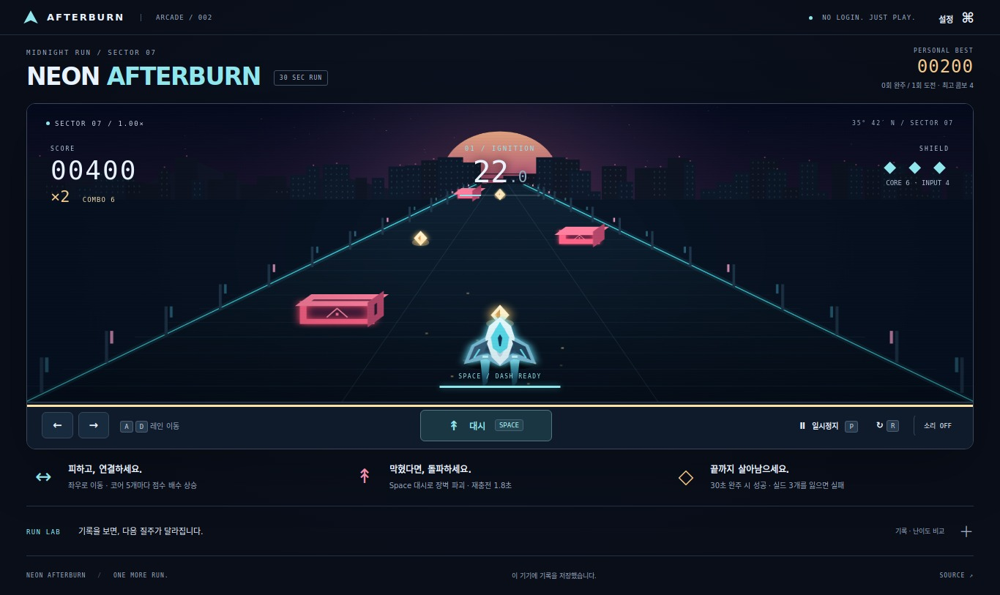
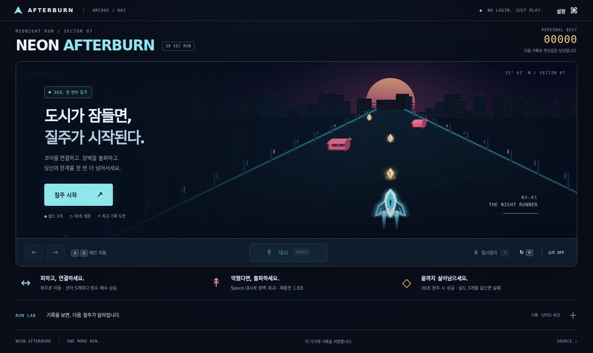

# NEON AFTERBURN

**도시의 마지막 30초. 코어를 연결하고, 장벽을 돌파하세요.**

기존 버그 피하기를 3레인 아케이드 러너로 교체했습니다. 원근감 있는 네온 도로와 호버크래프트, 연속 수집 콤보, 대시 파괴, 근접 회피, 같은 코스 재도전을 제공합니다.



## 플레이

| 행동 | 입력 | 효과 |
|---|---|---|
| 레인 이동 | ← / → 또는 A / D | 입력 1건당 한 레인 이동, 양 끝 경계 제한 |
| 대시 | Space 또는 대시 버튼 | 0.42초 동안 장벽 파괴, 1.8초 재충전 |
| 일시정지 | P 또는 버튼 | 시간·장애물·대시·재충전 모두 정지 |
| 같은 코스 재도전 | R 또는 버튼 | 같은 시드와 속도로 현재 판 초기화 |
| 새 코스 | 결과 화면 버튼 | 새로운 시드, 설정한 속도로 시작 |

- **성공:** 실드를 1개 이상 남기고 30초 완주.
- **실패:** 실드 3개 모두 손실.
- **수집:** 코어 50점 × 현재 배수. 연속 수집 5개마다 배수가 상승하며 최대 5배. 충돌하면 현재 콤보 초기화.
- **돌파:** 대시 중 장벽 파괴 100점 × 현재 배수. 코어를 안전하게 쫓을지, 대시로 추가 점수를 노릴지 선택합니다.
- **근접 회피:** 레인 변경 후 0.23초 이내 다른 레인의 장벽이 통과하면 장벽당 40점.
- **완주:** 남은 실드 1개당 150점 추가.
- **등급:** S 4000점 이상 / A 2500점 이상 / B 1200점 이상 / C 그 미만. 완주 여부는 별도로 표시합니다.
- 0~10초 IGNITION → 10~20초 OVERDRIVE → 20~30초 FINAL STRETCH. 후반부는 생성 간격이 짧아지고 접근이 빨라집니다.
- 모든 생성 묶음에는 장벽이 없는 코어 레인이 있습니다. 코스는 시드에 따라 결정되므로 재도전하면서 익힐 수 있습니다.



## 설치 없이 실행되는 정적 게임

Node.js 20 이상에서:

```bash
npm start
```

`http://127.0.0.1:4173`에서 실행합니다. ES 모듈이므로 file://로 HTML을 더블클릭하지 말고 HTTP를 사용하세요. 게임 자체에는 외부 라이브러리·폰트·오디오 샘플·서버 API가 필요 없습니다.

## 선택권과 저장

- 소리는 기본 OFF. 직접 켠 경우에만 Web Audio로 만든 짧은 합성 효과음을 재생합니다. 배경음악/자동재생/외부 음원이 없습니다.
- 수집·대시·장벽 파괴·피격·근접 회피·승리·패배 사건에서만 효과음이 발생합니다.
- 움직임 줄이기는 파티클·잔상·화면 흔들림·배경 움직임을 즉시 끕니다. OS 설정도 존중합니다. 판정에 필요한 트랙 진행은 유지합니다.
- 창/탭 이탈 또는 0.5초를 넘는 프레임 공백에서는 자동 정지, 직접 재개합니다.
- 최고 점수·최대 콤보·완주/시도 횟수·설정·최근 200판을 브라우저에 보존합니다.
- 손상/빈 저장은 기본값 복구, 저장이 차단되면 탭 안에서 계속 실행합니다.
- RUN LAB의 판단 입력은 내보내기에 포함되며 별도 저장하지 않습니다. 필요한 기록은 JSON으로 내보내세요.

## 난이도 비교

A 1.0× / B 1.15×에서 **접근 배수 하나만 변경**합니다. 같은 시드 10개, 동일한 3단계 생성 규칙, 실드·대시·점수 규칙을 유지합니다.

자동 파일럿(0.25초 반응, z<0.15 범위만 인식)의 실제 결과:

| 설정 | 판 수 | 점수 중앙값 | 점수 범위 | 생존 중앙값 | 완주 | 실패 |
|---|---:|---:|---:|---:|---:|---:|
| A 1.0× | 10 | 7470 | 1560–9210 | 30초 | 9 | 1 |
| B 1.15× | 10 | 7230 | 5140–9190 | 30초 | 10 | 0 |

기본값은 **1.0×**입니다. A는 점수 중앙값이 240점 높지만 B의 완주율이 더 높으므로 ‘A가 반드시 쉽다’고 주장하지 않습니다. 점수 추구와 반응 여유를 기준으로 1.0×를 선택하고, 더 빠른 도전은 1.15×로 제공합니다. 작은 자동 표본이며 사람의 재미/난이도를 입증하지 않습니다. RUN LAB에서 직접 A/B 20판을 기록할 수 있습니다.

[20판 원본](docs/evidence/automated-20-runs.json) · [조건 대응표](docs/acceptance.md) · [제출 안내](docs/submission.md)

## 검증 재현

```bash
npm ci
npx playwright install chromium
npm test
npm run experiment
```

첫 터미널:

```bash
npm start
```

두 번째 터미널:

```bash
npm run test:browser
npm run test:lab
npm run test:soak
```

- 단위: 엔진·연속 입력·대시·충돌·콤보·정지·시드·생성 규칙·저장 검증.
- 브라우저: 실제 화면/입력/성공/실패/복구/음소거/효과 감소. 기능 검사는 가상 시간 사용.
- LAB: 실제 UI에서 20판, 중도 재시작 제외, 통계·내보내기·재접속 검사.
- SOAK: 시간 가속 없이 실제 600초 동안 조작과 재시작. 실행한 소스의 SHA-256과 오류 수를 기록.
- 테스트용 상태 읽기 코드는 테스트에서만 응답에 삽입합니다. 배포 파일에 치트/테스트 전역 객체가 없습니다.

## 배포와 현재 제한

필수 정적 파일: `index.html`, `style.css`, `src/`. 호스팅 루트에서 게시합니다. 기존 Vercel 프로젝트는 `https://aleph-t02.vercel.app`이나 이번 브랜치 코드가 배포되었다고 가정하지 마세요. 이전 PR 자동 배포가 Blocked였고, 현재 연결에서는 상세 원인을 확인하지 못했습니다. 새 버전이 공개 배포된 후 시크릿 창으로 C01을 확인해야 합니다.

GitHub Issues 생성은 연결의 쓰기 권한 오류(403)로 차단되어 있습니다. [기능별 이슈 본문](docs/issues)과 생성 스크립트를 준비했습니다. 권한 있는 GitHub CLI 세션에서:

```bash
bash scripts/create-issues.sh
```

## 코드

- `src/engine.js`: 결정론적 게임 상태와 규칙
- `src/renderer.js`: Canvas 원근 투영·도시·기체·이벤트 효과
- `src/audio.js`: 원본 합성 효과음과 즉시 음소거
- `src/storage.js`: 저장 스키마 검증과 복구
- `src/app.js`: 화면·키보드·설정·비교 모드 연결

이전 버그 피하기 검증은 `docs/archive/bug-dodger/`에 보관했습니다. **현재 게임의 통과 증거로 사용하지 않습니다.**
